# SpoonDraft – Anleitung

SpoonDraft erzeugt Schnitzschablonen für Holzlöffel: Draufsicht, Seitenprofil und 3D-Vorschau, gespeichert als PDF, SVG oder Laser-SVG in Originalgröße. Diese Anleitung hat zwei Teile: [Erste Schritte](#erste-schritte) führt in fünf Schritten von der Löffelart bis zum Ausdruck, die [Referenz](#referenz) beschreibt jede Funktion einzeln.

[English version: GUIDE.md](GUIDE.md)

Die Bilder zeigen die deutsche Oberfläche. Die Sprache stellst du oben rechts ein, siehe [Sprache](#sprache).

## Erste Schritte

### 1. Löffelart wählen

Oben links wählst du, was du schnitzen willst: Esslöffel, Kochlöffel, Kaffeelöffel oder Schöpfkelle. Jede Art bringt eigene Startwerte mit. Das Blatt in der Mitte und die 3D-Ansicht zeigen sofort den Löffel dazu.

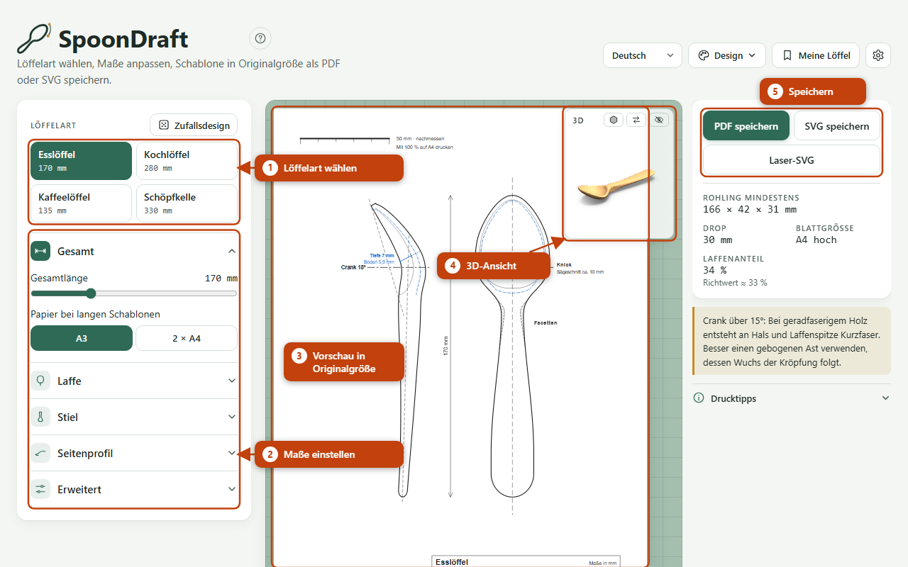

### 2. Maße anpassen

Unter der Löffelart liegen die Maße in fünf Gruppen: Gesamt, Laffe, Stiel, Seitenprofil und Erweitert. Klicke eine Gruppe an, um sie aufzuklappen, und ziehe die Regler. Jede Änderung siehst du sofort auf dem Blatt. Die Laffenform und das Griffende wählst du aus einem Katalog (Knopf „Formen“).

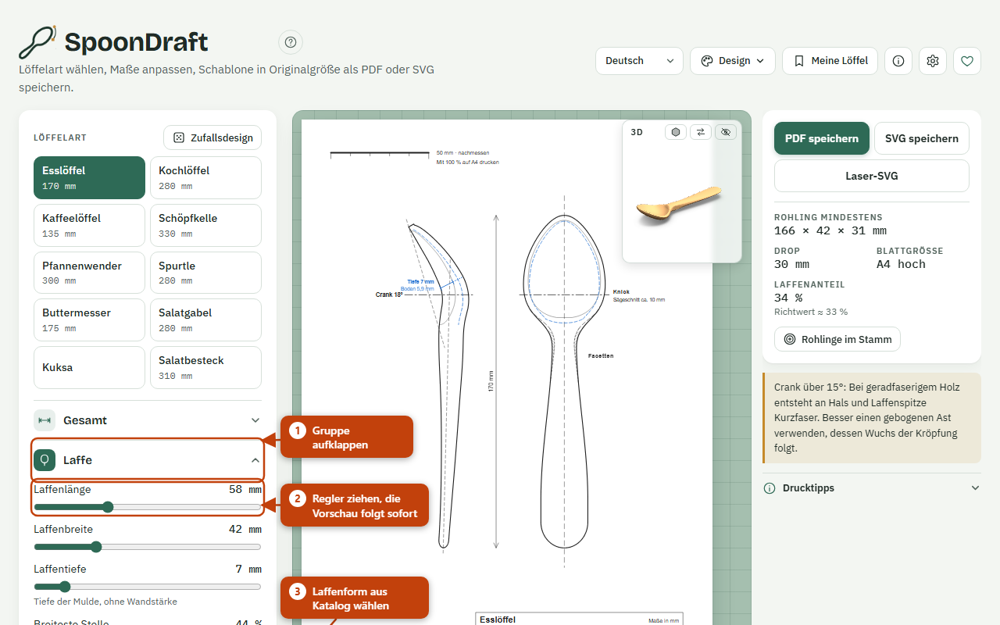

Als Anhaltspunkte stehen bei den Reglern Richtwerte: Crank-Winkel Kochlöffel 0–15°, Esslöffel 15–20°, Servierlöffel bis 30°, Kellen 60–90°; Knickposition bei Löffeln 25–33 % der Laffenlänge, bei Kellen nahe am Hals. Ein Esslöffel hat meist einen Laffenanteil von etwa einem Drittel der Gesamtlänge; die Angaben rechts zeigen deinen Wert.

### 3. Vorschau und 3D lesen

Das Blatt zeigt die Schablone in Originalgröße. Links steht das Seitenprofil mit der echten Biegung, rechts die Draufsicht als abgewickelter Umriss. Die waagrechte Knicklinie verbindet beide Ansichten; im Stiel stehen sie auf gleicher Höhe. Unten im Schriftfeld stehen die wichtigsten Maße, der Rohling und die Formkennungen.

Mit dem Mausrad zoomst du in die Vorschau, durch Ziehen verschiebst du sie, „Ganzes Blatt“ oder ein Doppelklick zeigt wieder alles. Das kleine 3D-Fenster zeigt den Löffel als Körper: Zum Drehen ziehen. Die drei Knöpfe oben im Fenster wechseln die Darstellung (Holz, Technisch, Drahtgitter), tauschen die Plätze von Zeichnung und 3D und blenden 3D aus.

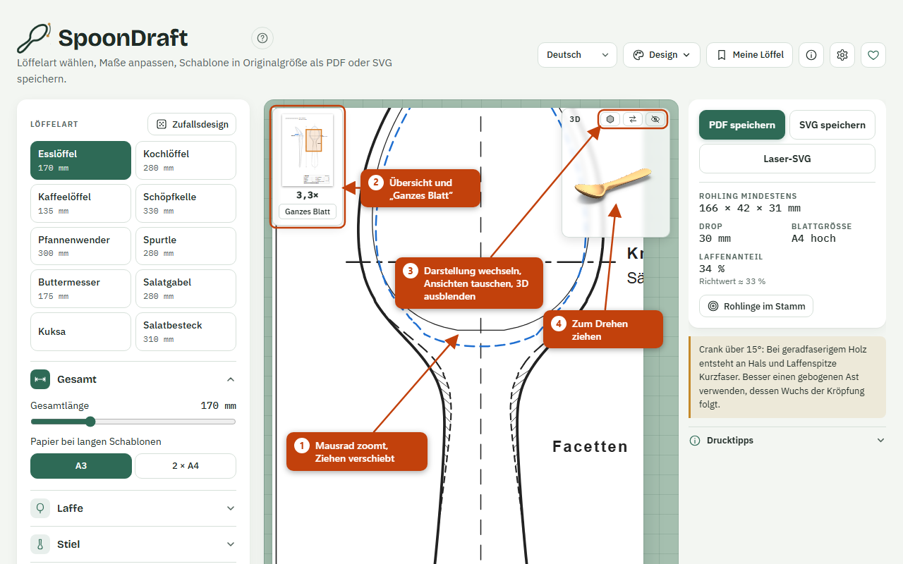

### 4. Als PDF, SVG oder Laser-SVG speichern

Rechts oben speicherst du die Schablone:

- **PDF speichern**: zum Drucken. Die Datei hat Originalgröße.
- **SVG speichern**: zum Weiterbearbeiten in einem Zeichenprogramm.
- **Laser-SVG**: für Laserschneider. Rot wird geschnitten, Blau graviert.

Die Dateien heißen zum Beispiel `spoondraft-essloeffel-170mm.pdf`. Alle Exporte funktionieren auch ohne Internetverbindung.

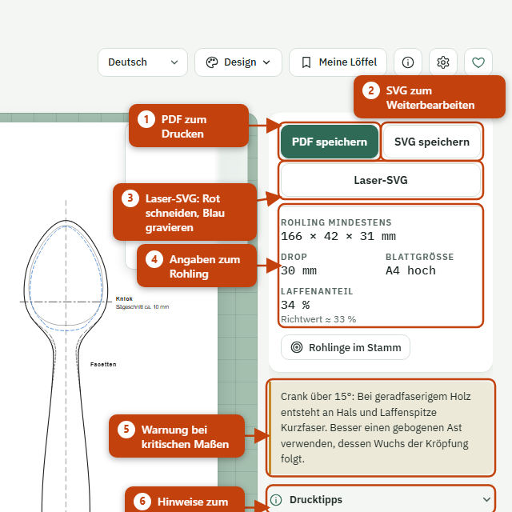

### 5. In Originalgröße drucken

1. Öffne die PDF-Datei und wähle im Druckdialog „Tatsächliche Größe“ oder 100 %. „An Seite anpassen“ verändert die Maße.
2. Miss nach dem Druck den 50-mm-Balken oben links nach. Stimmt er, stimmt die ganze Schablone.
3. Passt die Schablone nicht auf ein A4-Blatt, wählst du bei „Papier bei langen Schablonen“ A3 oder 2 × A4. Bei 2 × A4 druckst du beide Seiten, überlappst sie und legst die zweite Seite an der Linie „Kante von Seite 2 hier anlegen“ an.
4. Die Faser des Rohlings soll entlang des Stiels laufen. Schneide zuerst das Seitenprofil aus: Es ist der Ausgangspunkt, die Draufsicht folgt danach.

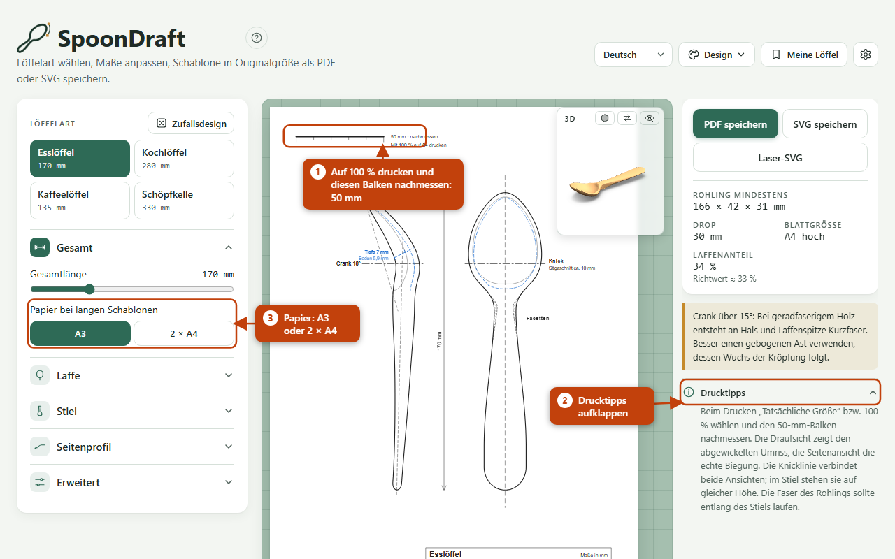

## Referenz

Jede Funktion hat einen eigenen Abschnitt. Das **Grundset** ist immer an. **Zusatzfunktionen** schaltest du im Dialog ⚙ („Standardwerte“, unten bei „Zusatzfunktionen“) einzeln ab; sie sind standardmäßig an.

### Grundset

#### Löffelart

**Grundset.** Vier Knöpfe oben im Bedienfeld: Esslöffel, Kochlöffel, Kaffeelöffel, Schöpfkelle. Ein Klick setzt alle Maße auf die Startwerte der Art (die Werkseinstellung oder deine [Standardwerte](#standardwerte)). Bisherige Änderungen gehen dabei verloren; sichere einen Entwurf vorher unter [Meine Löffel](#meine-loeffel).

#### Bedienfeld

**Grundset.** Hier stellst du alle Maße ein, in fünf Gruppen:

| Gruppe | Inhalt |
|---|---|
| Gesamt | Gesamtlänge (100–350 mm), Papier bei langen Schablonen |
| Laffe | Länge, Breite, Tiefe, breiteste Stelle, Laffenform, Händigkeit |
| Stiel | Halsbreite, größte Griffbreite, Griffende, Facettenlinien am Hals |
| Seitenprofil | Stielstärke am Hals, Crank-Winkel, Knickposition |
| Erweitert | Stielstärke am Griffende, Verdickung am Hals, Lage der größten Griffbreite, Übergang am Knick, Stielkrümmung, Laffe glätten, Wandstärke, Mindestwandstärke |

Die Gruppen klappen auf und zu. Laffenform und Griffende wählst du aus einer Galerie mit Vorschaubildern; die Kennungen (z. B. L01, G01) stehen im Schriftfeld der Schablone. Händigkeit spiegelt asymmetrische Laffenformen.

#### Formen

**Grundset.** Der Formenkatalog: Laffen und Griffenden, jeweils mit Kennung (Laffen L…, Griffenden G…). Dazu kommen die Formvorgaben Ei (LE), Feige (LF), Squoval (LS) und Oval (LO). Öffne die Galerie mit dem Knopf „Formen“ und klicke eine Form an. Eigene Formen aus dem [Formeditor](#editor) oder aus einem Bild ([Eigene Formen](#eigene-formen)) stehen in derselben Galerie.

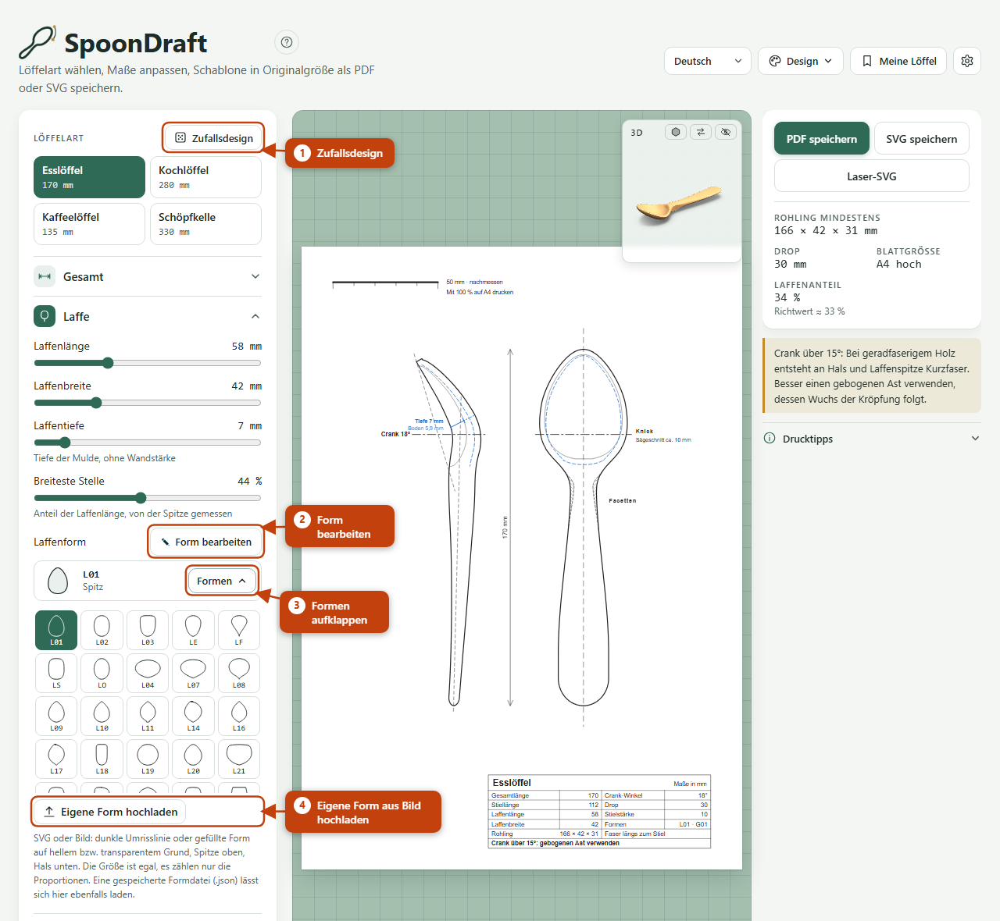

#### Geometrie

**Grundset.** Rechnet aus den Maßen die Schablone: Draufsicht mit abgewickeltem Umriss, Seitenprofil mit der echten Biegung, Facettenlinien, Knicklinie, Mittellinien und Schriftfeld. Alle Maße sind in Millimetern. Das Blatt ist A4, wenn die Schablone darauf passt; sonst gilt deine Wahl A3 oder 2 × A4 (Regler „Papier bei langen Schablonen“). Passt die Schablone auch nicht auf 2 × A4, nimmt SpoonDraft A3 und vermerkt „zu breit für A4“.

Die Facetten beginnen bis zu 10 mm (höchstens ein Fünftel der Laffenlänge) unter der Laffe als Fase an der Unterseite; in der Draufsicht ist dieses Stück gestrichelt. Die Breite der Fase stellst du mit dem Regler „Facettenbreite“ von 10 bis 60 % ein (in Schritten von 1 %); „Leicht“ (30 %) und „Achteckig“ bleiben als Schnellwahl, und sobald du den Regler verschiebst, steht die Facettenstärke auf „Eigene“.

Der Schalter „Laffe glätten“ (Gruppe „Erweitert“, ab Werk an) zeichnet die Unterseite der Laffe im Seitenprofil und in der 3D-Ansicht ohne Knicke; größte Tiefe, tiefste Stelle und Draufsicht bleiben, „Aus“ zeigt die bisherige Kontur.

Crank-Winkel und Knickposition hängen zusammen: Liegt der Knick weit hinten, ist nur ein begrenzter Crank möglich, sonst klappt die Laffenspitze über. Die Angaben warnen dann.

#### Vorschau

**Grundset.** Das Blatt in der Mitte zeigt die Schablone so, wie sie gedruckt wird. Es zeichnet sich bei jeder Änderung neu. Zusätzlich zeigt der Bildschirm Hilfslinien, die nicht in PDF und SVG landen (z. B. die der [Wandstärke](#wandstaerke)).

#### Zoom

**Grundset.** Mausrad: zoomen. Ziehen: verschieben. Doppelklick oder „Ganzes Blatt“: zurück zur Gesamtansicht. Eine Mini-Übersicht zeigt, welchen Ausschnitt du siehst.

#### 3D-Ansicht

**Grundset.** Der Löffel als Körper im kleinen Fenster oben rechts im Blatt. Ziehen dreht ihn. Drei Knöpfe im Kopf des Fensters:

- Darstellung wechseln: Holz, Technisch (grau mit Linien an Umriss, Laffenrand, Facetten und Kiel), Drahtgitter.
- Ansichten tauschen: 3D groß, Zeichnung klein, und zurück.
- Ausblenden: blendet 3D aus (Augensymbol).

Deine Wahl bleibt im Browser gespeichert.

#### Angaben und Warnungen

**Grundset.** Rechts neben dem Blatt stehen die Angaben: Rohling (kleinstes Holzstück, in dem der Löffel Platz hat), Drop, Blattgröße und Laffenanteil mit Richtwert. Darunter erscheinen Warnungen:

- Crank über 15° (Grenze einstellbar): Im geradfaserigen Holz entsteht Kurzfaser an Hals und Laffenspitze. Nimm einen gebogenen Ast.
- Crank größer als bei der Knickposition möglich.
- Esslöffel-Laffe größer als 45 × 65 mm oder tiefer als 8 mm (Grenzen einstellbar): zu groß für den Mund bzw. schwer leer zu essen.

Unter „Drucktipps“ stehen die Hinweise zum [Drucken](#5-in-originalgröße-drucken).

#### Speichern: PDF, SVG, Laser-SVG

**Grundset.** Drei Knöpfe rechts oben:

| Knopf | Datei | Inhalt |
|---|---|---|
| PDF speichern | `spoondraft-<Löffelart>-<Länge>mm.pdf` | Schablone in Originalgröße auf A4, A3 oder zwei A4-Seiten |
| SVG speichern | `….svg` | dieselbe Zeichnung als Vektordatei |
| Laser-SVG | `…-laser.svg` | ein Stück in Originalgröße in mm mit 5 mm Rand, nur Linien |

Das Laser-SVG zeigt dieselbe Zeichnung wie das SVG, also Draufsicht und Seitenprofil, abgeschnitten am Umriss jeder Ansicht, in zwei Farben. Rot (0,01 mm) wird geschnitten: der Umriss. Blau (0,1 mm) wird graviert: alle Linien innerhalb des Umrisses, also Mittellinie, Knicklinie, Facetten, Muldenlinie, Bezugslinien, Strichlinien und Schraffur; gestrichelte Linien bleiben gestrichelt. Was über den Umriss hinausragt, fällt weg, ebenso Reststücke unter 0,5 mm. Die blauen Linien reichen bis an den Umriss; stelle die Gravur so ein, dass sie nicht durchschneidet, sonst zerfällt die Schablone. Laser-Programme wie LightBurn oder xTool ordnen die Farben Ebenen zu. Nicht enthalten sind Texte, Füllungen, 50-mm-Balken, Maßpfeile, Schriftfeld und die Anlegelinien und Passkreuze von 2 × A4. Prüfe die Größe in deiner Laser-Software, bevor du schneidest.

Wo das Speichern nicht möglich ist (etwa in der eingebetteten Ansicht in claude.ai), gibt es stattdessen „SVG-Code kopieren“.

#### Sprache

**Grundset.** Die Auswahl oben rechts stellt die Oberfläche auf Deutsch, Niederländisch, Englisch, Französisch, Schwedisch, Spanisch, Italienisch, Norwegisch, Dänisch oder Polnisch um. Das Schriftfeld der Schablone folgt der Sprache; bei Polnisch ist es englisch. Die Wahl bleibt im Browser gespeichert.

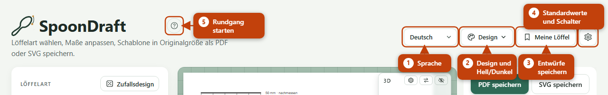

#### Design

**Grundset.** Das Menü „Design“ bietet vier Designs (Salbei, Ahorn, Papier & Terrakotta, Morgenhimmel) und die dunkle Darstellung. Beides ändert nur das Aussehen der Seite, nicht die Schablone.

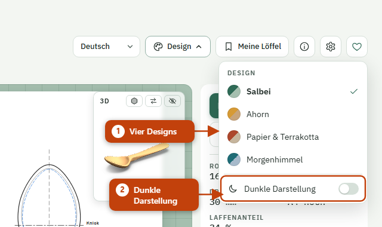

#### Standardwerte

**Grundset.** Der Knopf ⚙ öffnet den Dialog „Standardwerte“:

- **Für alle Löffelarten**: Felder, die in der Werkseinstellung für alle Arten gleich sind, hier mit einem Wert für alle.
- **Startwerte je Löffelart**: eigene Startwerte für die übrigen Felder. Sie gelten ab dem nächsten Klick auf eine Löffelart.
- **Richtwerte und Warngrenzen**: Laffenanteil, Crank-Warnung, Grenzen für die Esslöffel-Laffe.
- **Zusatzfunktionen**: ein Schalter je Zusatzfunktion, siehe unten.

Geänderte Werte sind markiert, ↺ setzt ein Feld zurück, „Auf Werkseinstellung“ setzt alles zurück. „Übernehmen“ speichert im Browser. Die Schalter der Zusatzfunktionen wirken sofort und liegen im Grundset, damit du eine abgeschaltete Funktion immer wieder anschalten kannst.

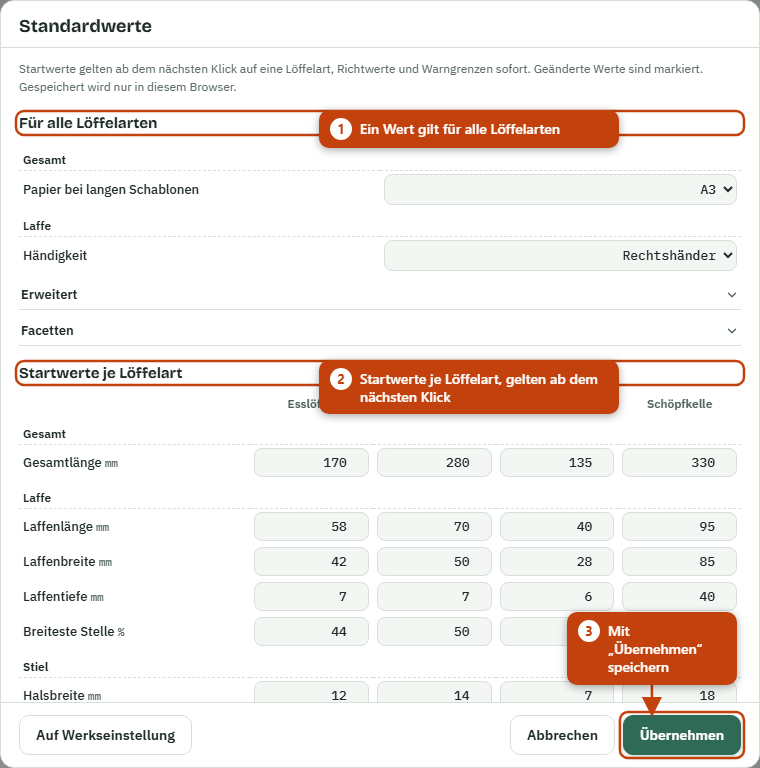

#### Spende und Zähler

**Grundset.** Ist der Betreiber bei Ko-fi angemeldet, steht in der Kopfzeile ein Herz-Symbol, in der Fußzeile und im Über-Dialog ein blauer Knopf „Unterstütze mich auf Ko-fi“; beide führen in einem neuen Tab zur Spendenseite. In der Seite selbst wird nichts bezahlt. Der Dienst GoatCounter kann auf der öffentlichen Seite Seitenaufrufe und Exporte (PDF, SVG, Laser-SVG, SVG-Code kopieren) ohne Cookies und ohne dauerhafte Kennung zählen; derzeit ist er ausgeschaltet. Ist er eingeschaltet, steht im Dialog [Über SpoonDraft](#ueber), was der Dienst dabei erhält. Wer die Seite als Datei öffnet, bekommt weder Zähler noch Spendenknopf; auch im Entwurf, solange Name und Adresse nicht eingetragen sind, bleiben beide aus.

#### Über SpoonDraft

**Grundset.** Der Knopf mit dem i in der Kopfzeile öffnet den Dialog „Über SpoonDraft“ mit Version, Lizenz, Links auf `LICENSE` und `THIRD-PARTY-NOTICES.md` und den Datenschutzhinweisen. Die Hinweise stehen nur auf Deutsch und Englisch.

### Zusatzfunktionen

Abgeschaltete Zusatzfunktionen verschwinden aus der Oberfläche, ihre Werte bleiben erhalten, und die Schablone ändert sich nicht.

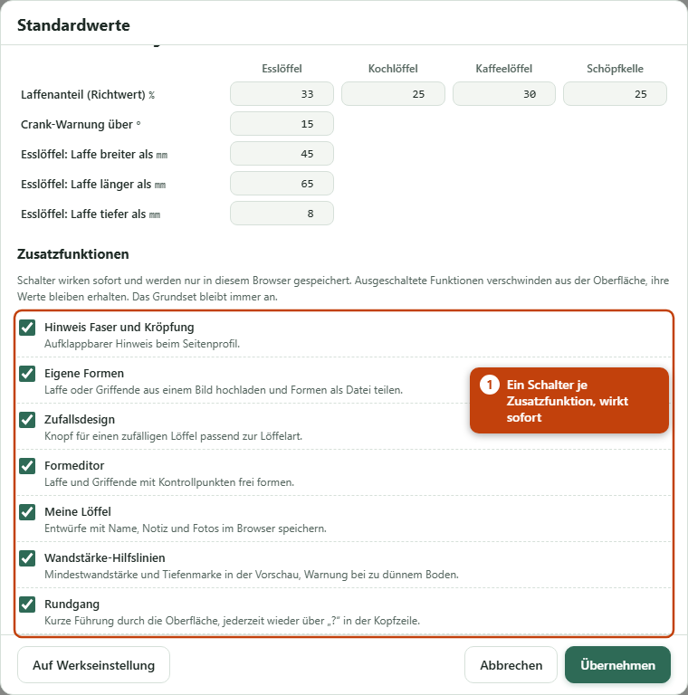

#### Hinweis Faser und Kröpfung

**Zusatzfunktion.** Ein aufklappbarer Hinweis als erste Zeile der Gruppe „Seitenprofil“. Er sagt: Zuerst das Seitenprofil aussägen, die Faser entlang des Stiels laufen lassen, bei geradem Holz nur wenig Kröpfung, für mehr einen Krummast wählen, dessen Wuchs dem Profil folgt.

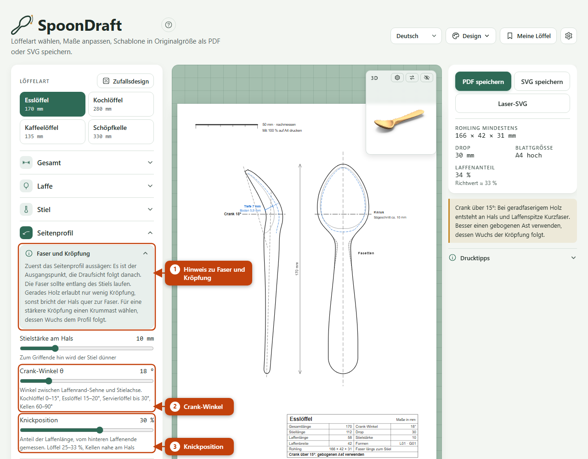

#### Eigene Formen

**Zusatzfunktion.** Laffe oder Griffende aus einem Bild hochladen: unter der Galerie „Eigene Form hochladen“. Geeignet ist eine SVG- oder Bilddatei mit einer dunklen Umrisslinie oder gefüllten Form auf hellem oder durchsichtigem Grund. Bei der Laffe zeigt die Spitze nach oben, der Hals nach unten; beim Griffende liegt der Ansatz am Stiel unten. Die Größe ist egal, nur die Proportionen zählen. Eigene Formen lassen sich entfernen und als Datei (`.json`) speichern, teilen und wieder laden.

#### Zufallsdesign

**Zusatzfunktion.** Der Knopf „Zufallsdesign“ neben der Löffelart würfelt Laffenform, Griffende und Maße in sinnvollen Grenzen um die Startwerte der gewählten Löffelart. Papier, Facettenlinien und Löffelart bleiben, eigene Formen werden nicht gewählt. Der Knopf ändert deine Maße; sichere Entwürfe, die du behalten willst, vorher unter [Meine Löffel](#meine-loeffel).

#### Formeditor

**Zusatzfunktion.** „Form bearbeiten“ neben Laffenform und Griffende öffnet den Editor. Du ziehst Kontrollpunkte; eine Kurve verbindet sie. Die Knöpfe „Punkt einfügen“ und „Punkt löschen“ fügen hinter dem gewählten Punkt einen neuen ein bzw. entfernen den gewählten; darunter steht, wie viele Punkte die Hälfte hat. Ein Doppelklick auf die Linie fügt ebenfalls einen Punkt hinzu, ein Doppelklick auf einen Punkt (oder Entf) entfernt ihn, Strg+Z macht rückgängig. Je Hälfte sind 4 bis 32 Punkte möglich. „Symmetrisch“ und „Asymmetrisch“ legen fest, ob beide Hälften gleich sind. Eine Live-Draufsicht zeigt den ganzen Löffel, Warnungen weisen auf Überhang, Engstellen und ungewöhnliche Proportionen hin. „Bild zum Nachzeichnen“ legt ein Bild hinter die Zeichenfläche. „Übernehmen“ speichert die Form als eigene Form, „Als SVG speichern“ exportiert sie.

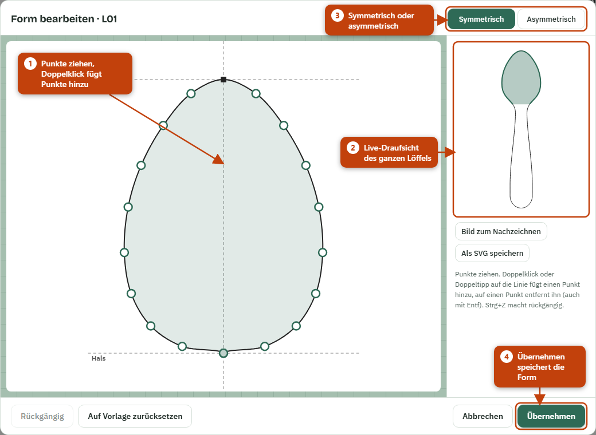

#### Meine Löffel

**Zusatzfunktion.** Der Knopf „Meine Löffel“ öffnet eine Liste mit deinen Entwürfen. „Aktuellen Stand speichern“ legt einen Eintrag mit Maßen, Name, Notiz und bis zu drei Fotos des fertigen Löffels an. Mit „Laden“ holst du einen Entwurf zurück, mit „Bearbeiten“ änderst du Name, Notiz und Fotos, mit „Löschen“ entfernst du ihn. Die Einträge liegen nur in diesem Browser; Fotos landen nie auf der Schablone. „Sicherung speichern“ und „Sicherung laden“ schützen vor Datenverlust, „Als Datei teilen“ gibt einen einzelnen Entwurf weiter.

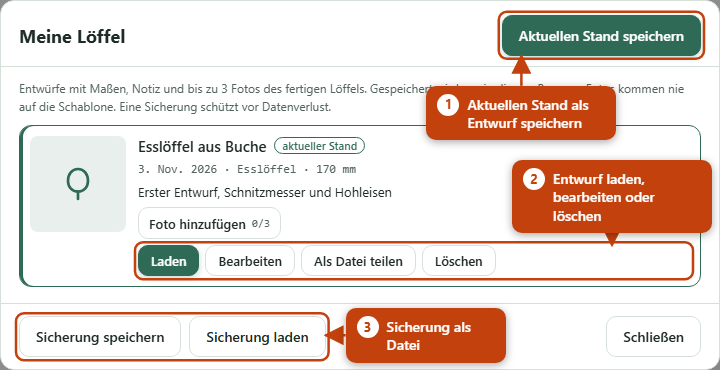

#### Wandstärke-Hilfslinien

**Zusatzfunktion.** Mit dem Regler „Mindestwandstärke“ (Gruppe Erweitert) zeichnet die Vorschau gestrichelte blaue Hilfslinien: in der Draufsicht um das Maß nach innen versetzt vom Laffenrand, im Seitenprofil unter der Mulde. Eine Tiefenmarke am tiefsten Punkt zeigt die Muldentiefe und den Restboden. Ist der Boden dünner als die Mindestwandstärke, wird die Marke rot und eine Warnung erscheint: Nur bis zur gestrichelten Linie aushöhlen. Die Hilfslinien erscheinen nur am Bildschirm, nicht in PDF und SVG.

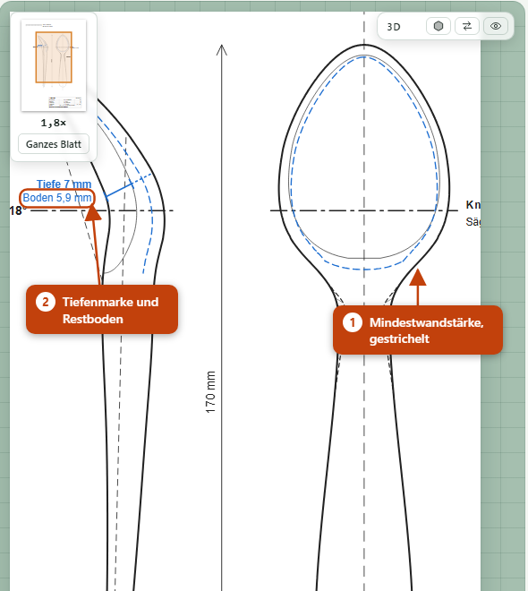

#### Rundgang

**Zusatzfunktion.** Beim ersten Besuch bietet SpoonDraft einen kurzen Rundgang an. Er hebt nacheinander Löffelart, Maße, Vorschau, 3D-Ansicht, Speichern-Knöpfe und ⚙ hervor und erklärt sie in einer Sprechblase; der letzte Schritt zeigt den Knopf „?“ und verlinkt diese Anleitung. „Weiter“ und „Zurück“ blättern, Esc beendet. Du kannst die Seite währenddessen weiter bedienen. Über den Knopf „?“ neben dem Namen startest du den Rundgang jederzeit neu.

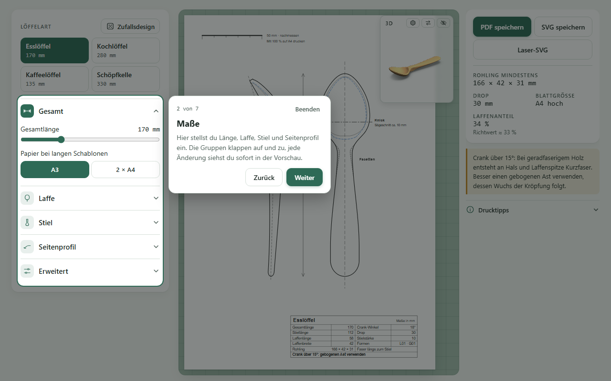

#### Rohlinge im Stamm

**Zusatzfunktion.** Der Knopf „Rohlinge im Stamm“ unter den Angaben öffnet den Dialog „Stammquerschnitt“. Du gibst Stammdurchmesser (cm), Rindendicke (mm) und den Abstand zum Mark (mm) ein; SpoonDraft zeigt, wie viele Rohlinge der aktuellen Löffelart in den Stamm passen. Der Rohling geht mit Breite × Höhe in den Querschnitt ein, seine Länge läuft längs des Stamms. Die Zeichnung zeigt die Rohlinge nummeriert, ihre Rindenseite orange, dazu Rinde, Mark und den Abstand zum Mark gestrichelt. Gerechnet wird ohne Sägefuge. Die Eingaben merkt sich der Browser; die Zeichnung erscheint nur am Bildschirm, nicht in PDF und SVG.

#### Pfannenwender

**Zusatzfunktion.** In der Löffelart-Leiste steht hinten „Pfannenwender“. Statt der Mulde hat er ein flaches Blatt: Blattlänge, Blattbreite und Blattdicke stellst du in der Gruppe „Blatt“ ein, dazu die Schräge der Vorderkante (0° = gerade, sonst liegt die vordere Ecke rechts). Die Unterseite des Blatts bleibt eben; zur Vorderkante hin läuft das Blatt auf etwa ein Drittel der Dicke aus, die gestrichelte Linie in der Draufsicht zeigt, wo das Ausdünnen beginnt. Die Kröpfung (Gruppe „Seitenprofil“) hebt den Stiel am Übergang zum Hals um den eingestellten Winkel an. Stiel und Griffende wählst du wie beim Löffel, auch Facetten und Kiel (Gruppe „Stiel“) sowie Stielstärke am Griffende, Verdickung am Hals und Lage der größten Griffbreite (Gruppe „Erweitert“); die Facetten sind ab Werk aus, eingeschaltet erscheinen sie in Draufsicht, Seitenprofil und 3D-Ansicht. Die Angaben zeigen Rohling und Papier.

#### Spurtle

**Zusatzfunktion.** In der Löffelart-Leiste steht hinten „Spurtle“, ein Rührstab ohne Mulde. In der Gruppe „Stab“ wählst du unter „Bauform“ den runden Stab oder den flachen Spurtle. Beim runden Stab stellst du den Durchmesser an der dicksten Stelle („Durchmesser am Griff“) und an der Spitze ein, dazu die Länge der Verjüngung: Von der Spitze bis dorthin wird der Stab dicker. Die Spitze ist rund (halbkugelig) oder flach-oval; flach-oval wird sie zur Spitze hin auf die halbe Dicke abgeflacht und ist dann nur im Seitenprofil dünner. Beim flachen Spurtle ist „Durchmesser am Griff“ die Blattbreite (30 bis 60 mm); das Blatt ist 8 mm dick, im Querschnitt linsenförmig und geht zum Griff hin in einen runden Griff über, Seitenprofil und Draufsicht sind dann verschieden. Unter „Wulst vom Griffende“ setzt du den Ring, der auf dem Topfrand aufliegt (0 = ohne); beim runden Stab ist der Stab 30 mm darunter am dicksten. Unter „Kopf“ wählst du das Griffende: glatt (dann wie beim Löffel aus den Formen), Distel, Knauf oder gerade abgeschnitten. Daneben zeigen zwei Querschnitte die Maße an Spitze bzw. Blatt und Griff; ist der Stab für Wulst, Kopf oder Verjüngung zu kurz, steht ein Hinweis im Schriftfeld. Die Angaben zeigen den Rohling und das Papier.

#### Buttermesser

**Zusatzfunktion.** In der Löffelart-Leiste steht hinten „Buttermesser“, ein Messer mit flacher Klinge. In der Gruppe „Klinge“ wählst du die Klingenform und stellst Klingenlänge, Klingenbreite, die Dicke am Rücken und an der Kante sowie die Rundung der Spitze ein; in der Gruppe „Griff“ Griffbreite und Griffdicke. „Streichmesser“ hat eine gerade Klinge mit kurzem Übergang zum Griff, die erst zur Schneide hin dünn ausläuft. Beim Streichmesser bleibt die Kante mindestens 2 mm dick (Richtwert nach Alexander); stellst du weniger ein, steht ein Hinweis im Schriftfeld. „Schwedisch“ folgt dem Buttermesser (smörkniv) von Jögge Sundqvist: ein flacher, biegsamer Streicher ohne scharfe Schneide, gleichmäßig vom Rücken zur Kante dünner, der Griff wird zur Klinge hin allmählich dünner und am Übergang bleibt etwas mehr Holz stehen. Die Werkseinstellung sind seine Richtwerte: 175 mm lang, Griff 20 mm dick, Klinge vom Rücken 6 mm zur Kante 3 mm. Die Galerie „Klingenform“ bietet außerdem „Blatt“, „Spatel“, „Breit“ und „Geschwungen“ (beim Wählen passen sich Klingenlänge, Klingenbreite und Griffbreite an, die Rundung der Spitze entfällt). Mit dem Stift ✎ formst du die Klinge im Formeditor selbst, getrennt für Rücken (links) und Kante (rechts); sie steht danach als eigene Form K01, K02 … in der Galerie, lässt sich als Formdatei speichern und auch aus einem Bild laden. „Griffform“ macht den Griff gerade, zum Ende breiter oder bauchig, wobei die Griffbreite an der breitesten Stelle gilt. Die Draufsicht zeigt den Umriss mit dem Rücken links und der Kante rechts, das Seitenprofil die Dicke vom Griff über die Klinge, gestrichelt die Dicke an der Kante. Daneben stehen der Faserpfeil (die Faser läuft ohne Unterbrechung vom Griff bis zur Spitze) und zwei Querschnitte durch Klinge und Griff. Die Angaben zeigen Rohling und Papier.

#### Salatgabel

**Zusatzfunktion.** In der Löffelart-Leiste steht hinten „Salatgabel“, eine flache Gabel fürs Salatbesteck. Den Kopf stellst du wie eine flache Laffe ein: Laffenlänge, Laffenbreite und eine Form aus den Formen. In der Gruppe „Zinken“ wählst du die Zinkenzahl (2 bis 4), die Zinkenlänge von der Spitze bis zum Ende der Schlitze, die Schlitzbreite und das Schlitzende: rund, wenn du am Ende ein Loch in Schlitzbreite bohrst und bis dorthin sägst, gerade, wenn du ganz mit der Säge schneidest. Die Schlitze laufen parallel zur Mittellinie, an ihrem Ende sind alle Zinken gleich breit; sind sie dort schmaler als 4 mm, steht ein Hinweis im Schriftfeld. Stiel, Griffende und Kröpfung stellst du wie beim Löffel ein. Die Draufsicht zeigt den Umriss mit den Schlitzen als eine Schnittlinie, das Seitenprofil den Kopf geschlossen und leicht gewölbt, halb so dick wie der Stiel am Hals. Die Angaben zeigen Rohling und Papier.

#### Kuksa

**Zusatzfunktion.** In der Löffelart-Leiste steht hinten „Kuksa“, eine Trinkschale aus einem Stück Holz mit Griff. In der Gruppe „Schale“ stellst du Innendurchmesser, Wandstärke, Tiefe und Bodenstärke ein, dazu den Schwundzuschlag quer zur Faser. Frisches Holz schwindet beim Trocknen quer zur Faser stärker als längs; deshalb sind Außen- und Innenkreis in der Draufsicht quer zur Faser um diesen Anteil zur Ellipse gestreckt, damit die Kuksa trocken rund wird. Für Birke sind etwa 5 % ein guter Wert. Die Wandstärke gilt am Rand längs zur Faser, quer kommt der Zuschlag dazu. Die Schalenform ist gerade (Wand fast senkrecht, Boden gerundet), kugelig oder bauchig (unter dem Rand am breitesten, der Rand wieder enger; die Draufsicht zeigt dann die breiteste Stelle als Umriss und den Rand gestrichelt). Die Werkseinstellung folgt den Richtwerten von Lamon: 180 mm lang, Schale außen 109 mm, Wand 4,5 mm, Bohrung 32 mm; für eine flache Guksi stellst du die Tiefe auf 30 mm und die Form auf „Gerade“. In der Gruppe „Griff“ wählst du einen kurzen Griff mit einem Fingerloch, einen Griff mit zwei Fingerlöchern übereinander, einen Ohrgriff ohne Loch oder „Mulde“: einen Henkel, der vom Rand aus um etwa 25° ansteigt und unten eine Fingermulde hat, 4 mm breiter als der Finger. Die Fingerbreite ist ein Handmaß: Miss den Finger, der durchs Loch soll; das Loch wird 4 mm größer. Die Grifflänge zählt von der Außenwand (bauchig von der breitesten Stelle) bis zum Griffende; ist sie zu kurz für das Loch oder die Mulde, verlängert SpoonDraft den Griff und schreibt einen Hinweis ins Schriftfeld. Die Draufsicht zeigt den Außenkreis, gestrichelt den Innenkreis, Mittelpunkt, Mittellinien und den Faserpfeil, die Fingerlöcher verdeckt gestrichelt. Das Seitenprofil darunter zeigt die Schale im Schnitt mit Wand und Boden, den Griff am Rand und die Fingerlöcher als Kreise. Der Griff mit zwei Löchern schließt oben immer bündig mit dem Rand ab; brauchen die Löcher mehr Höhe, als die Schale hat, reicht er nach unten, notfalls bis unter den Boden, dann steht ein Hinweis im Schriftfeld. Beim Griff mit einem Loch steht der Griff über den Rand, wenn die Schale für das Loch zu flach ist. Die Angaben zeigen Rohling, Papier und das Fassungsvermögen bis zum Rand.

#### Salatbesteck

**Zusatzfunktion.** In der Löffelart-Leiste steht hinten „Salatbesteck“: zwei Teile als Paar auf einem Blatt, zum Beispiel Löffel und Gabel. Länge, Laffe, Stiel, Griffende und Kröpfung stellst du einmal für beide Teile ein. In der Gruppe „Paar“ wählst du den Kopf von Teil A und Teil B: Laffe mit Mulde (Tiefe über die Laffentiefe), Gabel mit Zinken (Gruppe „Zinken“ wie bei der Salatgabel) oder Paddel, einen flachen Kopf ohne Schlitze, oder Laffe mit Loch: eine Laffe mit Mulde und einem Loch (Größe unter „Lochdurchmesser“, höchstens 40 % der Laffenbreite, sonst rechnet SpoonDraft mit dem größten passenden Loch und nennt es im Schriftfeld), das in einer geraden Nut zur Spitze ausläuft. Unter „Teil B“ macht „Gespiegelt“ Teil B bei asymmetrischen Laffenformen zum Spiegelbild von Teil A; bei symmetrischen Formen ändert sich nichts. Das Blatt zeigt links das gemeinsame Seitenprofil von Teil A; ist der Kopf von Teil B anders dick, ist seine Unterseite gestrichelt eingezeichnet. Daneben stehen die Draufsichten A und B mit je einer Schnittlinie. Das Schriftfeld nennt den Rohling von Teil A und Teil B (Länge × Breite × Höhe; eine Laffe braucht mehr Höhe als ein Paddel) und einen Rohling für beide Teile nebeneinander (10 mm Abstand); passt die Zeichnung nicht auf A3 (sehr lang, sehr breit oder stark gekröpft), steht dort ein Hinweis. Die Angaben zeigen die drei Rohlinge und das Papier. Stiel, Facetten, Übergang am Knick, Stielkrümmung und Händigkeit stellst du wie beim Löffel ein, sie gelten für beide Teile (ab Werk sind die Facetten aus); Wandstärke und Mindestwandstärke erscheinen, sobald ein Teil eine Mulde hat.
