# SpoonDraft – Guide

SpoonDraft creates carving templates for wooden spoons: top view, side profile and a 3D preview, saved as PDF, SVG or laser SVG at full size. This guide has two parts: [Getting started](#getting-started) takes you from the spoon type to the printout in five steps, the [Reference](#reference) describes each feature on its own.

[Deutsche Version: ANLEITUNG.md](ANLEITUNG.md)

The pictures show the English interface. You change the language at the top right, see [Language](#sprache).

## Getting started

### 1. Choose a spoon type

At the top left you choose what you want to carve: eating spoon, cooking spoon, coffee spoon or ladle. Each type comes with its own start values. The sheet in the middle and the 3D view show the matching spoon right away.

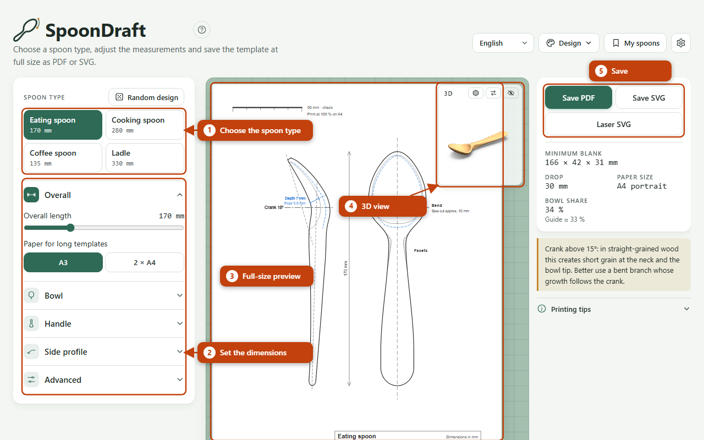

### 2. Adjust the dimensions

Below the spoon type the dimensions sit in five groups: Overall, Bowl, Handle, Side profile and Advanced. Click a group to open it and drag the sliders. You see every change on the sheet at once. You pick the bowl shape and the handle end from a catalogue (button “Shapes”).

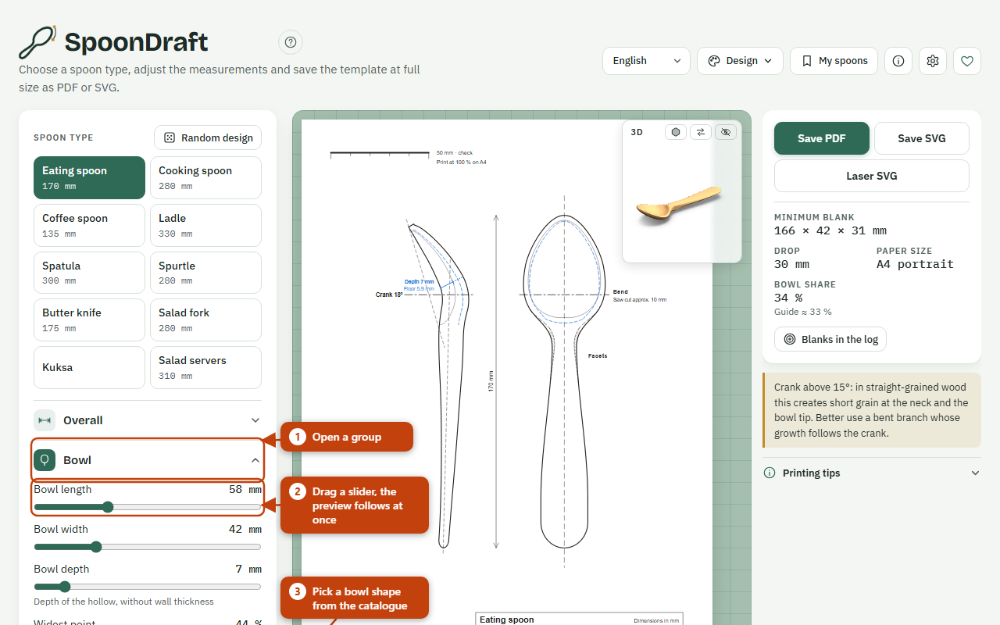

The sliders carry guide values: crank angle for cooking spoons 0–15°, eating spoons 15–20°, serving spoons up to 30°, ladles 60–90°; crank position for spoons 25–33 % of the bowl length, for ladles close to the neck. An eating spoon usually has a bowl share of about a third of the overall length; the details on the right show your value.

### 3. Read the preview and the 3D view

The sheet shows the template at full size. The side profile with the real bend is on the left, the top view as a flattened outline on the right. The horizontal crank line links both views; along the handle they line up. At the bottom, the title block lists the main dimensions, the blank and the shape codes.

The mouse wheel zooms into the preview, dragging pans it, “Whole sheet” or a double-click shows everything again. The small 3D window shows the spoon as a solid: drag to rotate. The three buttons at the top of the window change the style (Wood, Technical, Wireframe), swap the places of the drawing and 3D, and hide 3D.

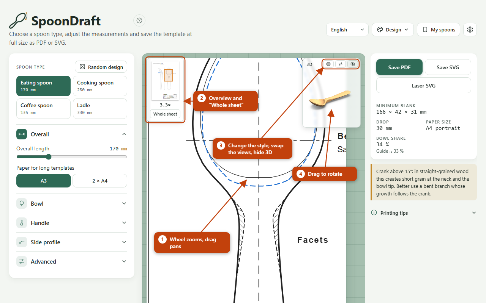

### 4. Save as PDF, SVG or laser SVG

At the top right you save the template:

- **Save PDF**: for printing. The file is at full size.
- **Save SVG**: for editing in a drawing program.
- **Laser SVG**: for laser cutters. Red is cut, blue is engraved.

Files are named like `spoondraft-eating-spoon-170mm.pdf`. The PDF export loads a library from the internet; without a connection, save as SVG.

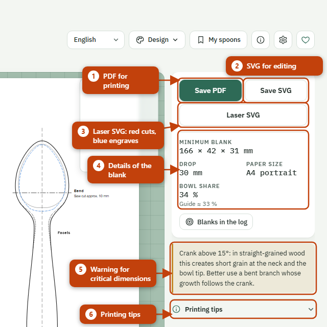

### 5. Print at full size

1. Open the PDF and choose “Actual size” or 100 % in the print dialog. “Fit to page” changes the dimensions.
2. After printing, measure the 50 mm bar at the top left. If it is right, the whole template is right.
3. If the template doesn’t fit on one A4 sheet, choose A3 or 2 × A4 under “Paper for long templates”. With 2 × A4 you print both pages, overlap them and place the second page at the line “Place edge of page 2 here”.
4. The grain of the blank should run along the handle. Cut out the side profile first: it is the starting point, the top view follows.

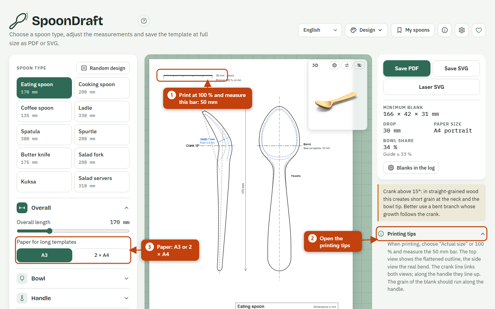

## Reference

Each feature has its own section. The **core set** is always on. You switch **extra features** off one by one in the “Default values” dialog ⚙ (at the bottom, under “Extra features”); they are on by default.

### Core set

#### Spoon type

**Core set.** Four buttons at the top of the settings panel: eating spoon, cooking spoon, coffee spoon, ladle. A click resets all dimensions to the start values of that type (the factory settings or your [default values](#standardwerte)). Changes you made so far are lost; save a design under [My spoons](#meine-loeffel) first.

#### Settings panel

**Core set.** Here you set all dimensions, in five groups:

| Group | Content |
|---|---|
| Overall | Overall length (100–350 mm), paper for long templates |
| Bowl | Length, width, depth, widest point, bowl shape, handedness |
| Handle | Neck width, maximum handle width, handle end, facet lines at the neck |
| Side profile | Handle thickness at the neck, crank angle, crank position |
| Advanced | Handle thickness at the end, thickening at the neck, position of the widest handle point, transition at the crank, handle curve, wall thickness, minimum wall |

The groups open and close. You choose the bowl shape and the handle end from a gallery with thumbnails; the codes (for example L01, G01) appear in the title block of the template. Handedness mirrors asymmetric bowl shapes.

#### Shapes

**Core set.** The shape catalogue: bowls and handle ends, each with a code (bowls L…, handle ends G…). The shape presets Egg (LE), Fig (LF), Squoval (LS) and Oval (LO) come on top. Open the gallery with the “Shapes” button and click a shape. Your own shapes from the [shape editor](#editor) or from an image ([Your own shapes](#eigene-formen)) appear in the same gallery.

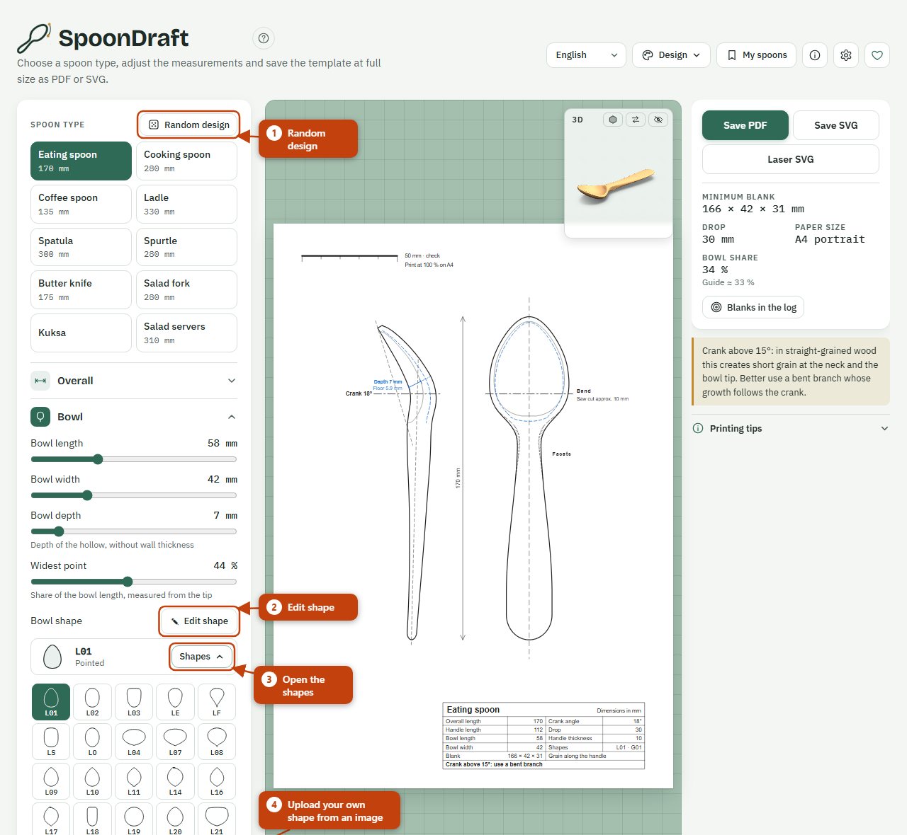

#### Geometry

**Core set.** Calculates the template from the dimensions: top view with the flattened outline, side profile with the real bend, facet lines, crank line, centre lines and title block. All dimensions are in millimetres. The sheet is A4 if the template fits on it; otherwise your choice of A3 or 2 × A4 applies (slider “Paper for long templates”). If the template doesn’t fit on 2 × A4 either, SpoonDraft uses A3 and adds “too wide for A4”.

The facets start up to 10 mm (at most a fifth of the bowl length) under the bowl as a chamfer on the underside; in the top view this part is dashed.

Crank angle and crank position depend on each other: with the crank far back only a limited crank angle is possible, otherwise the bowl tip folds over. The details warn you in that case.

#### Preview

**Core set.** The sheet in the middle shows the template as it will be printed. It redraws with every change. On screen it also shows guides that don’t end up in PDF and SVG (for example those of the [wall thickness](#wandstaerke)).

#### Zoom

**Core set.** Mouse wheel: zoom. Drag: pan. Double-click or “Whole sheet”: back to the full view. A mini overview shows which part you are looking at.

#### 3D view

**Core set.** The spoon as a solid in the small window at the top right of the sheet. Dragging rotates it. Three buttons in the window header:

- Change style: Wood, Technical (grey with lines at the outline, bowl rim, facets and keel), Wireframe.
- Swap views: 3D large, drawing small, and back.
- Hide: hides 3D (eye symbol).

Your choice is kept in the browser. The 3D view loads a library from the internet.

#### Details and warnings

**Core set.** To the right of the sheet you find the details: minimum blank (the smallest piece of wood the spoon fits in), drop, paper size and bowl share with a guide value. Warnings appear below:

- Crank above 15° (limit can be changed): in straight-grained wood this creates short grain at the neck and the bowl tip. Use a bent branch.
- Crank larger than the crank position allows.
- Eating spoon bowl larger than 45 × 65 mm or deeper than 8 mm (limits can be changed): too big for the mouth, or hard to empty.

Under “Printing tips” you find the notes on [printing](#5-print-at-full-size).

#### Save: PDF, SVG, laser SVG

**Core set.** Three buttons at the top right:

| Button | File | Content |
|---|---|---|
| Save PDF | `spoondraft-<spoon type>-<length>mm.pdf` | template at full size on A4, A3 or two A4 pages |
| Save SVG | `….svg` | the same drawing as a vector file |
| Laser SVG | `…-laser.svg` | one piece at full size in mm with a 5 mm margin, lines only |

The laser SVG contains all lines of the template, so top view and side profile, in two colours. Red (0.01 mm) is cut: the outline. Blue (0.1 mm, continuous) is engraved: centre line, crank line, facets, reference lines and dashed lines. Laser software such as LightBurn or xTool assigns the colours to layers. Not included are texts, hatching, fills, the 50 mm bar, dimension arrow, title block, hollow lines and the placement lines of 2 × A4. Check the size in your laser software before you cut.

Where saving isn’t possible (for example in the embedded view in claude.ai), “Copy SVG code” appears instead.

#### Language

**Core set.** The selector at the top right switches the interface to German, Dutch, English, French, Swedish, Spanish, Italian, Norwegian, Danish or Polish. The title block of the template follows the language; for Polish it is in English. Your choice is kept in the browser.

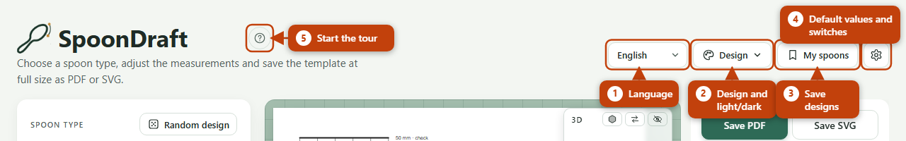

#### Design

**Core set.** The “Design” menu offers four designs (Sage, Maple, Paper & Terracotta, Morning sky) and dark mode. Both change only the look of the page, not the template.

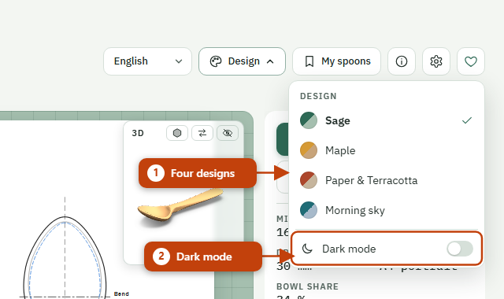

#### Default values

**Core set.** The ⚙ button opens the “Default values” dialog:

- **For all spoon types**: fields that are the same for all types in the factory settings, here with one value for all.
- **Start values per spoon type**: your own start values for the remaining fields. They apply from the next click on a spoon type.
- **Guide values and warning limits**: bowl share, crank warning, limits for the eating spoon bowl.
- **Extra features**: one switch per extra feature, see below.

Changed values are marked, ↺ resets a field, “Factory settings” resets everything. “Apply” saves in the browser. The switches for the extra features take effect at once and are part of the core set so that you can always switch a feature back on.

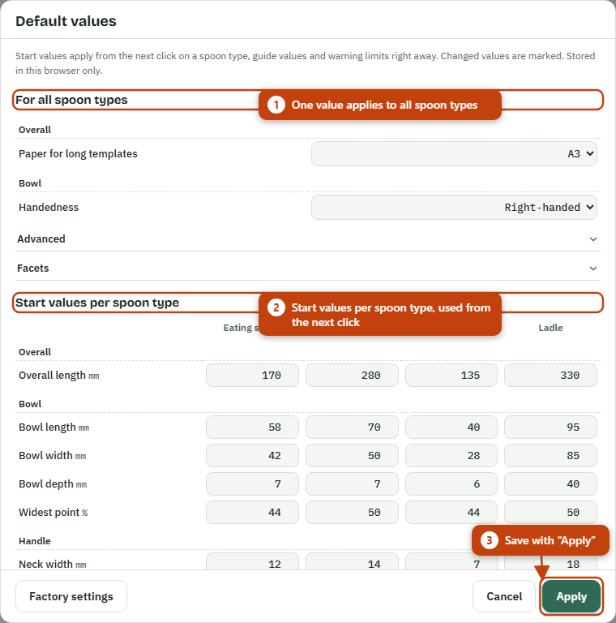

#### Donations and counter

**Core set.** Once the operator has a Ko-fi page, a heart icon appears in the header; it opens the donation page in a new tab. Nothing is paid inside the page itself. On the public site the service GoatCounter counts page views and exports (PDF, SVG, laser SVG, copy SVG code) anonymously: no cookies, no identifiers, no personal data. If you open the page as a file, you get neither counter nor donation button; both also stay off as long as the name and address are not set.

### Extra features

Extra features you switch off disappear from the interface, their values are kept, and the template doesn’t change.

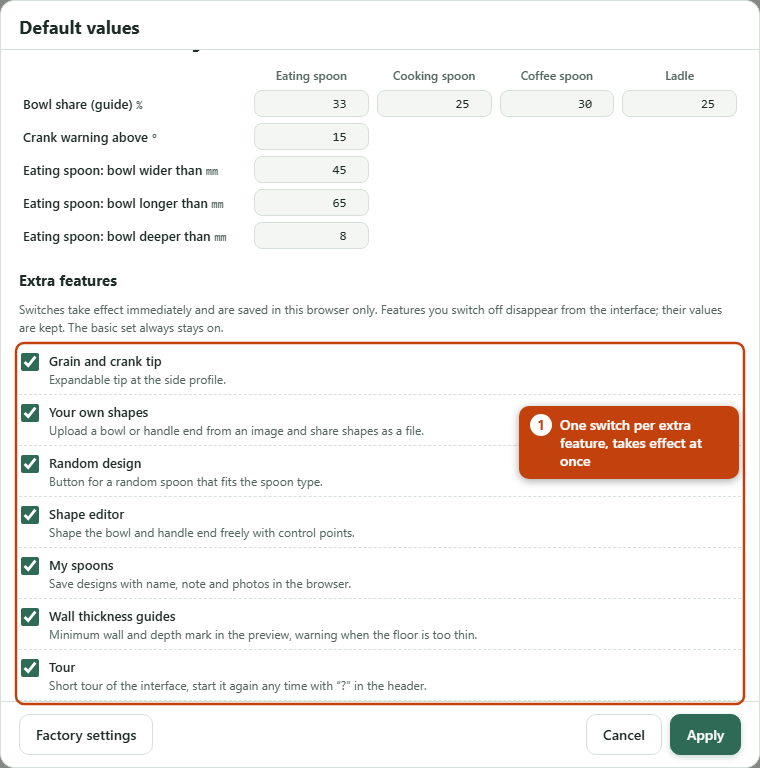

#### Grain and crank tip

**Extra feature.** An expandable tip as the first row of the “Side profile” group. It says: cut out the side profile first, let the grain run along the handle, allow only a little crank in straight wood, and for more choose a naturally curved branch whose growth follows the profile.

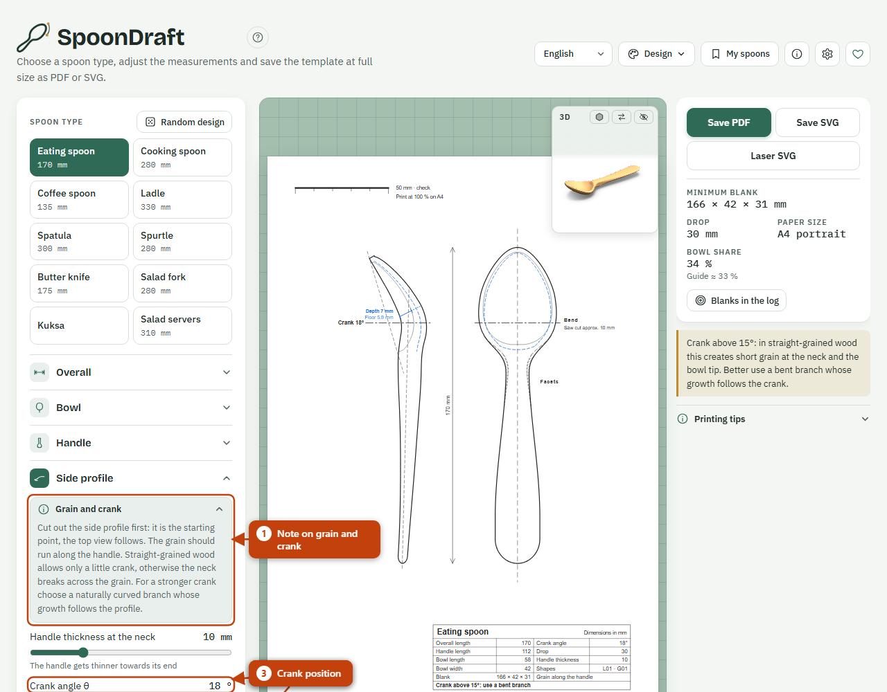

#### Your own shapes

**Extra feature.** Upload a bowl or handle end from an image: “Upload your own shape” below the gallery. A suitable file is an SVG or image with a dark outline or a filled shape on a light or transparent background. For a bowl the tip points up and the neck down; for a handle end the joint with the handle is at the bottom. Size doesn’t matter, only the proportions count. You can remove your own shapes, and save, share and load them again as a file (`.json`).

#### Random design

**Extra feature.** The “Random design” button next to the spoon type rolls a bowl shape, a handle end and dimensions within sensible limits around the start values of the chosen spoon type. Paper, facet lines and spoon type stay, own shapes are not picked. The button changes your dimensions; save designs you want to keep under [My spoons](#meine-loeffel) first.

#### Shape editor

**Extra feature.** “Edit shape” next to the bowl shape and the handle end opens the editor. You drag control points; a curve joins them. A double-click on the line adds a point, a double-click on a point (or Delete) removes it, Ctrl+Z undoes. Each half takes 4 to 16 points. “Symmetric” and “Asymmetric” decide whether both halves are the same. A live top view shows the whole spoon, and warnings point out overhangs, narrow points and unusual proportions. “Image to trace” puts an image behind the drawing area. “Apply” saves the shape as your own shape, “Save as SVG” exports it.

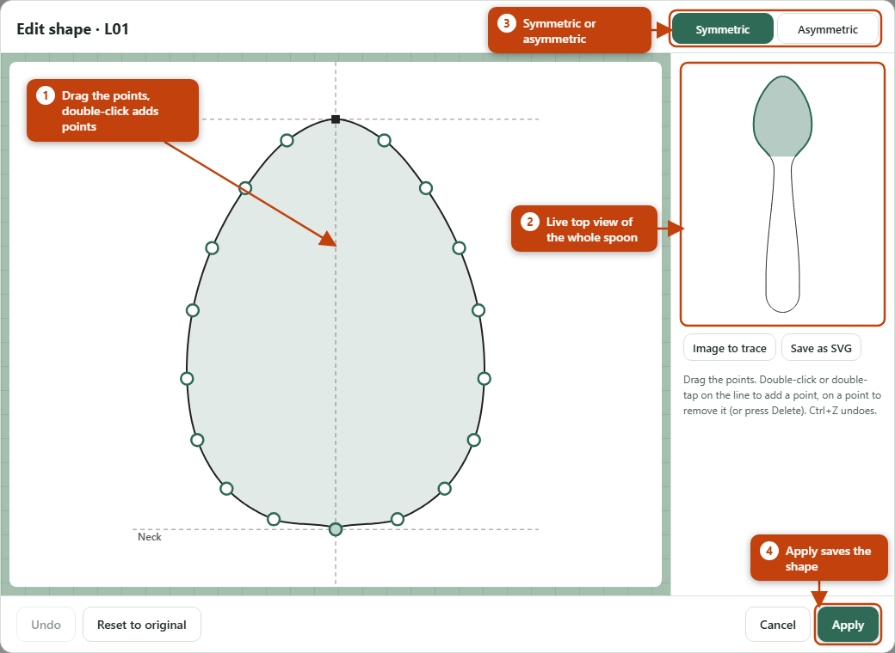

#### My spoons

**Extra feature.** The “My spoons” button opens a list of your designs. “Save current design” creates an entry with dimensions, name, note and up to three photos of the finished spoon. “Load” brings a design back, “Edit” changes name, note and photos, “Delete” removes it. Entries are stored in this browser only; photos never end up on the template. “Save backup” and “Load backup” protect against data loss, “Share as file” passes on a single design.

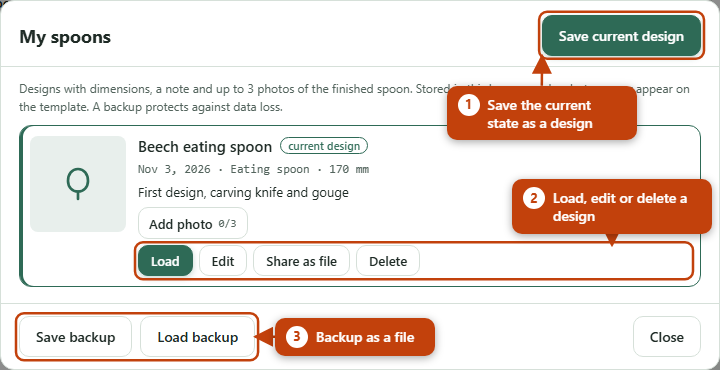

#### Wall thickness guides

**Extra feature.** With the “Minimum wall” slider (Advanced group) the preview draws dashed blue guides: in the top view offset inwards from the bowl rim by that amount, in the side profile under the hollow. A depth mark at the deepest point shows the depth of the hollow and the remaining floor. If the floor is thinner than the minimum wall, the mark turns red and a warning appears: only hollow out as far as the dashed line. The guides appear on screen only, not in PDF and SVG.

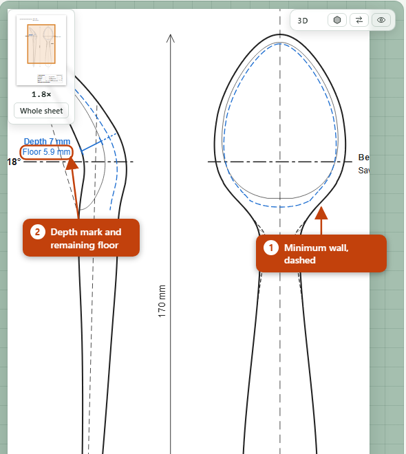

#### Tour

**Extra feature.** On your first visit SpoonDraft offers a short tour. It highlights spoon type, dimensions, preview, 3D view, save buttons and ⚙ one after another and explains each in a speech bubble; the last step shows the “?” button and links to this guide. “Next” and “Back” page through, Esc ends it. You can keep using the page during the tour. The “?” button next to the name starts the tour again at any time.

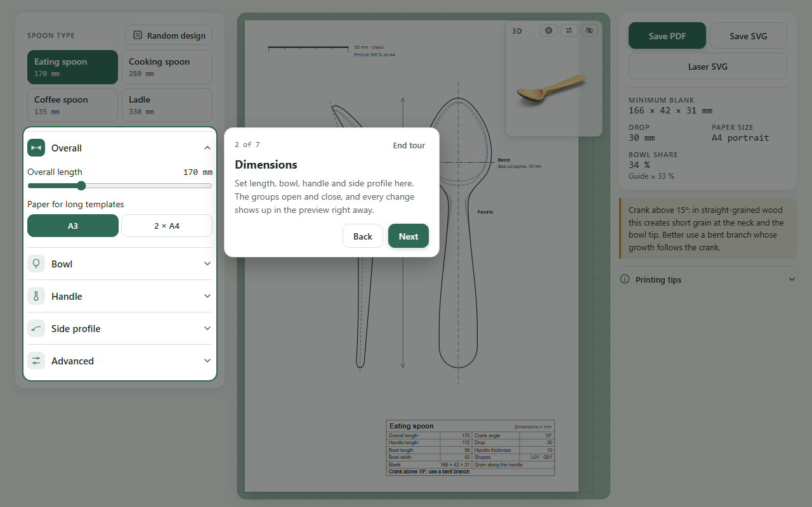

#### Blanks in the log

**Extra feature.** The “Blanks in the log” button below the details opens the “Log cross-section” dialog. Enter the log diameter (cm), bark thickness (mm) and distance from the pith (mm); SpoonDraft shows how many blanks of the current spoon type fit in the log. The blank's width × height make up the cross-section, its length runs along the log. The drawing shows the blanks numbered with their bark side in orange, plus bark, pith and the distance from the pith as a dashed circle. No saw kerf is included. The browser remembers your input; the drawing appears on screen only, not in PDF and SVG.

#### Spatula

**Extra feature.** The spoon type bar ends with “Spatula”. Instead of a bowl it has a flat blade: set blade length, width and thickness in the “Blade” group, plus the front edge angle (0° = straight, otherwise the front corner is on the right). The underside of the blade stays flat; towards the front edge the blade thins out to about a third of its thickness, and the dashed line in the top view shows where the thinning starts. The crank (“Side profile” group) raises the handle by the set angle where the blade meets the neck. Handle and handle end work as for spoons. The details show blank and paper.

#### Spurtle

**Extra feature.** The spoon type bar ends with “Spurtle”, a stirring stick without a bowl. In the “Shaft” group choose under “Form” the round stick or the flat spurtle. For the round stick set the diameter at the thickest point (“Diameter at the handle”) and at the tip, plus the taper length: from the tip up to that point the stick gets thicker. The tip is round (hemispherical) or flat oval; a flat oval tip is flattened to half the thickness towards the end and is thinner in the side profile only. For the flat spurtle “Diameter at the handle” is the blade width (30 to 60 mm); the blade is 8 mm thick with a lens-shaped cross-section and turns into a round handle, so side profile and top view differ. “Collar from the handle end” sets the ring that rests on the pot rim (0 = none); on the round stick the shaft is thickest 30 mm below it. Under “Top” choose the handle end: smooth (then chosen from the shapes as for spoons), thistle, knob or cut straight. Next to the views two cross-sections show the sizes at the tip or blade and at the handle; if the stick is too short for collar, top or taper, a note appears in the title block. The details show the blank and the paper.

#### Butter knife

**Extra feature.** The spoon type bar ends with “Butter knife”, a knife with a flat blade and a round tip. In the “Blade” group choose the blade shape and set blade length, blade width, the thickness at the spine and at the edge, and the tip rounding; the “Handle” group holds handle width and thickness. “Spreader” has a straight blade with a short transition to the handle that only thins out towards the edge; its edge stays at least 2 mm thick (guide value after Alexander), and if you set less, the title block shows a note. “Swedish” follows Jögge Sundqvist’s butter knife (smörkniv): a flat, flexible spreader without a sharp edge, thinning evenly from spine to edge; the handle gets gradually thinner towards the blade, and a little more wood stays at the transition. The defaults are his guide values: 175 mm long, handle 20 mm thick, blade 6 mm at the spine and 3 mm at the edge. The top view shows the outline with the spine on the left and the edge on the right, the side profile the thickness from handle to blade, dashed the thickness at the edge. Next to them are the grain arrow (the grain runs unbroken from handle to tip) and two cross-sections through blade and handle. The details show blank and paper.

#### Salad fork

**Extra feature.** The spoon type bar ends with “Salad fork”, a flat fork for salad servers. Set the head like a flat bowl: bowl length, bowl width and a shape from the shapes. In the “Tines” group choose the number of tines (2 to 4), the tine length from the tip to the end of the slots, the slot width and the slot end: round if you drill a hole of slot width at the end and saw up to it, straight if you saw all the way. The slots run parallel to the centre line and all tines are equally wide at the slot end; if they are narrower than 4 mm there, the title block shows a note. Set handle, handle end and crank as for spoons. The top view shows the outline with the slots as one cut line, the side profile shows the head closed and slightly curved, half as thick as the handle at the neck. The details show blank and paper.

#### Kuksa

**Extra feature.** The spoon type bar ends with “Kuksa”, a drinking cup carved from one piece of wood, with a handle. In the “Cup” group set inner diameter, wall thickness, depth and bottom thickness, plus the shrinkage allowance across the grain. Green wood shrinks more across the grain than along it while drying, so the outer and inner circle in the top view are stretched across the grain by this share into ellipses; the kuksa then dries round. For birch about 5 % works well. The wall thickness applies at the rim along the grain; across the grain the allowance is added. The cup shape is straight (wall almost vertical, rounded bottom), round or bellied (widest below the rim, narrower again at the rim; the top view then shows the widest point as the outline and the rim dashed). The factory settings follow Lamon’s guide values: 180 mm long, cup 109 mm across outside, wall 4.5 mm, hole 32 mm; for a flat guksi set the depth to 30 mm and the shape to “Straight”. In the “Handle” group choose a short handle with one finger hole, a handle with two finger holes one above the other, an ear handle without a hole, or “Finger rest”: a handle that rises about 25° from the rim with a finger hollow underneath, 4 mm wider than the finger. The finger width is a hand measure: measure the finger that goes through the hole; the hole is 4 mm larger. The handle length runs from the outer wall (bellied: from the widest point) to the end of the handle; if it is too short for the hole or the finger rest, SpoonDraft lengthens the handle and adds a note to the title block. The top view shows the outer circle, the inner circle dashed, centre, centre lines and the grain arrow, and the finger holes dashed as hidden lines. The side profile below shows the cup in section with wall and bottom, the handle at the rim and the finger holes as circles. If two holes need more height than the cup has, the handle rises above the rim. The details show blank, paper and the capacity up to the rim.

#### Salad servers

**Extra feature.** The spoon type bar ends with “Salad servers”: two parts as a pair on one sheet, for example a spoon and a fork. Length, bowl, handle, handle end and crank apply to both parts. In the “Pair” group choose the head of part A and part B: bowl with a hollow (depth from the bowl depth), fork with tines (“Tines” group as for the salad fork) or paddle, a flat head without slots, or bowl with hole: a bowl with a hollow and a hole (size under “Hole diameter”, at most 40 % of the bowl width, otherwise SpoonDraft uses the largest hole that fits and names it in the title block) that runs out to the tip in a straight channel. Under “Part B”, “Mirrored” makes part B the mirror image of part A for asymmetric bowl shapes; symmetric shapes stay the same. The sheet shows the shared side profile of part A on the left; if the head of part B has a different thickness, its underside is drawn dashed. Next to it are the top views A and B, each with its own cut line. The title block gives the blank for part A and part B (length × width × height; a bowl needs more height than a paddle) and one blank for both parts side by side (10 mm apart); if the drawing does not fit on A3 (very long, very wide or strongly cranked), a note appears there. The details show the three blanks and the paper.
