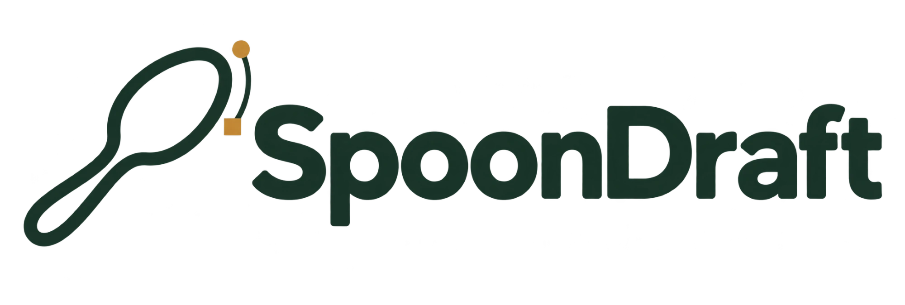

# SpoonDraft – Spoon Template Generator

Generator für Schnitzschablonen von Holzlöffeln (Esslöffel, Kochlöffel, Kaffeelöffel, Schöpfkelle) mit Draufsicht, Seitenprofil, 3D-Vorschau und Export als PDF/SVG. Sprachen: DE, NL, EN, FR, SV, ES, IT, NB, DA, PL.

> **Beta:** Diese Version ist eine Beta, Nutzung ohne Gewähr.

## Benutzen
Direkt im Browser: https://hoewimi.github.io/Spoon-Template-Generator/

Oder `index.html` herunterladen und im Browser öffnen – keine Installation nötig. Für den PDF-Export und die 3D-Ansicht braucht die Seite eine Internetverbindung.

Aktuelle Version: 37

## Datenschutz
Die Seite liegt bei GitHub Pages; GitHub verarbeitet beim Aufruf Protokolldaten, darunter die IP-Adresse. jsPDF und three.js kommen von cdnjs (Cloudflare), auch Cloudflare erhält dabei die IP-Adresse. Die Schriften stecken in der Datei selbst, es gibt keinen Abruf bei Google.

Einstellungen und Entwürfe, auch Fotos, bleiben in deinem Browser (localStorage, IndexedDB). Die Seite setzt keine Cookies. Ein Zähler (GoatCounter) und ein Spendenlink (Ko-fi) sind nur aktiv, wenn sie in der veröffentlichten Fassung eingeschaltet sind. Den genauen Stand nennt der Dialog „Über SpoonDraft“ in der Seite.

## Lizenz
Open Source unter der [ISC-Lizenz](LICENSE). Copyright (c) 2026 hoewimi. Bestandteile anderer Urheber und ihre Lizenzen stehen in [THIRD-PARTY-NOTICES.md](THIRD-PARTY-NOTICES.md).

## Anleitung
Erste Schritte und Referenz zu jeder Funktion, bebildert: [Deutsch](ANLEITUNG.md) · [English](GUIDE.md).
